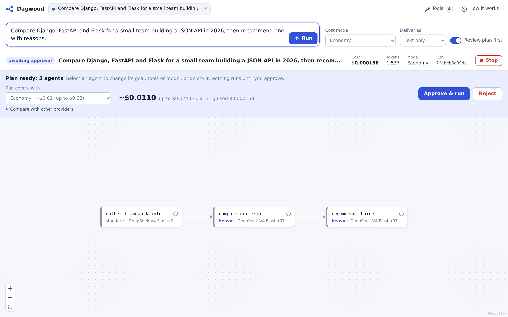

# Dagwood

*Layered agents, stacked in a DAG.*

A small, readable planner-executor system for LLM agents, built to learn (and teach) agent
orchestration and harness engineering.

You describe a task. A **planner** model turns it into a DAG of worker agents. You **review and
edit** the plan, then a **LangGraph executor** runs the agents in dependency order, in parallel
where it can. Each agent sees only the outputs of the steps it depends on. The UI shows the graph,
streams each agent's output, thoughts and tool calls live, and tracks tokens and cost.

```
task ──► planner ──► plan checks ──► human review ──► LangGraph executor ──► answer / PDF / slides
           ▲              │          (edit, re-route,     │   │   │
           └── retry ◄────┘           approve, reject)   agent agent agent  (each with tool + token caps)
```

**Stack:** Python 3.13 · [pydantic-ai](https://ai.pydantic.dev) agents · [LangGraph](https://langchain-ai.github.io/langgraph/)
execution · FastAPI + SSE · SQLite · React + React Flow · models on [DeepInfra](https://deepinfra.com)
(one API key) · optional tools via [Composio](https://composio.dev).

## Learn from this repo

Dagwood is meant to be read and poked at. If you want to learn how agents pass work to each
other, where a human can step in, and what drives cost, start with the article
[Learn how agents work by watching them](docs/article.md). It walks through one real run screen
by screen, explains what broke during development, and ends with exercises.



| To learn about | Do this in the UI | Then read |
| --- | --- | --- |
| How a task becomes a plan | Submit a task, look at the graph; resubmit with a different **Agents** count or **Agent types** and compare | `factory.py`: planner prompt and validator |
| Human-in-the-loop | Keep "Review plan first" on; edit, delete, approve or reject steps; press Stop mid-run | `api.py`: `_after_planning`, approve/reject/edit endpoints |
| How agents communicate | Click a finished agent, open "Inputs from upstream agents" | `executor.py`: `render_prompt`, `clip` |
| Parallelism and failure | Run a plan with parallel steps; make one fail | `executor.py`: LangGraph edges, skip logic |
| Cost | Compare the estimate with each agent's run stats | `executor.py`: `agent_limits`; `estimate.py` |

## What's in here

| Concern | Where | What to look at |
| --- | --- | --- |
| Planning | `orchestrator/factory.py` | Supervisor prompt; output validator that rejects bad plans (cycles, unknown tools, flat plans with no dependencies) and asks the model to retry |
| Plan schema | `orchestrator/schema.py` | `DAGNode` / `DAGPlan`, topological order, validation |
| Execution | `orchestrator/executor.py` | Compiles a plan into a LangGraph `StateGraph`; fan-out/fan-in; skipping downstream of failures; per-agent usage limits |
| Data flow between agents | `orchestrator/executor.py` | An agent's prompt contains only its `depends_on` outputs (truncated), not the whole run |
| Run lifecycle | `orchestrator/manager.py` | Background tasks, hard stop, per-user concurrency limit and FIFO queue |
| Model routing | `orchestrator/models.py` | Planner assigns each agent a tier (light/standard/heavy); a cost mode maps tiers to models |
| Cost estimates | `orchestrator/estimate.py`, `pricing.py` | Forecast learned from this server's own past runs (median and p90 per agent kind) |
| Tools | `orchestrator/tools.py`, `custom_tools.py`, `catalog.py`, `composio_source.py` | A built-in tool, a placeholder for writing your own, a pluggable tool catalog, scoped per-agent MCP toolsets, destructive tools blocked |
| Live output | `orchestrator/live.py`, `api.py` | pydantic-ai stream events → in-memory feed → SSE |
| Persistence | `orchestrator/store.py` | Event log + SQLite snapshots; runs survive restarts |
| Deliverables | `orchestrator/documents.py` | Structured `DocumentSpec` → PDF (WeasyPrint, no network fetches), HTML slides, PPTX; charts dropped unless their numbers appear in the step's input; any finished run's final answer can also be downloaded as a plain PDF with no model call (`/runs/{id}/export.pdf`) |
| UI | `ui/src/` | Graph layout, plan editor, approval bar, live feed |

## Quick start

You need **Python 3.13**, **Node 20.19+ or 22.12+** (required by Vite 8), and a **DeepInfra API key**
(create one at [deepinfra.com/dash/api_keys](https://deepinfra.com/dash/api_keys)). That's the only
key required. A Composio key is optional and adds web search and app tools; see
[below](#optional-web-search-and-app-tools-composio).

### 1. Backend

```bash
python3.13 -m venv .venv
source .venv/bin/activate
pip install -r requirements.txt

cp .env.example .env        # then set DEEPINFRA_API_KEY
```

PDF output uses WeasyPrint, which needs Pango from your OS:

- Debian/Ubuntu/WSL: `sudo apt install libpango-1.0-0 libpangoft2-1.0-0 libharfbuzz-subset0`
- macOS: `brew install pango`
- Windows: use WSL

### 2. Run the tests (no keys needed)

```bash
python -m pytest -q tests
```

The suite uses pydantic-ai's test and function models, so it makes no network calls and costs
nothing. It's also a good way to read how each piece behaves.

### 3. Start it

```bash
uvicorn orchestrator.api:app --reload           # API on http://localhost:8000
```

```bash
cd ui
npm install
npm run dev                                     # UI on http://localhost:5173
```

Open http://localhost:5173 and type a task. Try **Economy** mode first. To steer the planner,
set **Agents** (how many) and **Agent types** (for example `researcher, critic`, or your own like
`fact checker`). Both are optional hints: the planner follows them where the task allows. Typical runs there cost
a fraction of a cent: a 3-agent run cost $0.0005 in November 2026. Model prices change often, so
treat every figure as an estimate (see [Limitations](#limitations-read-before-you-rely-on-it)).

### Optional: web search and app tools (Composio)

**You only need the DeepInfra key to run Dagwood.** Without Composio, agents have two built-in
tools (`calc` and the example custom tool `team_handbook`) and answer from the model's own knowledge, so anything
about current events, prices or news may be out of date. The planning, review, execution and cost
tracking all work the same.

[Composio](https://composio.dev) adds web search and a large catalog of app toolkits (GitHub, Gmail,
Slack, Notion, ...). It has a free plan; check [its pricing page](https://composio.dev/pricing)
for current limits.

**1. Create an account and get an API key**

1. Sign up at [dashboard.composio.dev](https://dashboard.composio.dev). A default project is
   created for you.
2. Open **Settings → API Keys** in that project and copy the key.
3. Add it to `.env`:

   ```bash
   COMPOSIO_API_KEY=your-key-here
   ```

4. Restart the backend. (`--reload` does not watch `.env`.)

To check the setup without spending anything on models, run `python scripts/check_composio.py`.
It should list `composio:composio_search` as connected and end with `OK`.

**2. Web search works straight away**

With the key set, the **Tools** button in the top bar shows *Composio Search* under **Enabled**.
It needs no account, and the planner gives it to any step that needs current information. Try a
task like "What changed in Python packaging this month?" and look at the search agent's tool calls.

**3. Add more toolkits**

1. Click **Tools**, search the **Composio catalog** (for example `github`), and click **Enable**.
   Enabling only makes a toolkit available to the planner. It decides per task which agents get it,
   and you can change that per agent when you review the plan.
2. Toolkits marked **needs account** act on your behalf, so you must connect an account once.
   Keep **Review plan first** switched on and submit a task that uses the toolkit. The approval bar
   then shows "*Gmail* needs a connected account" with a **Connect** link.
3. **Connect** opens Composio's sign-in page for that app in a new tab. Approve access there, come
   back, and click **Re-check connections**. Approving the plan is blocked until every toolkit in
   it is connected. The connection is stored by Composio, so you do this once per app.

Things to know:

- **Enable only what a task needs.** Agents read untrusted text from the web, and a connected
  toolkit can act on your real accounts.
- **Destructive tools are blocked.** Anything Composio tags as destructive (deleting things, for
  example) is hidden from agents unless you set `COMPOSIO_ALLOW_DESTRUCTIVE=true`.
- **Connections belong to a Composio user id**, `default` unless you set `COMPOSIO_USER_ID`.
  Change it and you start with no connected accounts.
- **Tool calls count against your Composio plan**, separately from model costs. Dagwood's cost
  figures cover models only.
- To disconnect an app, remove the connected account in the Composio dashboard.

All other settings (models, limits, storage paths) are documented in `.env.example`.

### Write your own tool

`orchestrator/custom_tools.py` is the place to start. It holds one working placeholder,
`team_handbook`, which answers from a small made-up fact sheet, and its header explains the
pattern. To see it work, submit:

> When is our team's next deploy window, and who do I ask about access?

The planner gives the tool to an agent, and the agent's tool calls show up in its panel. Then make
it yours:

1. Write a function with **typed parameters** and a **docstring**. The model reads both to decide
   when and how to call it. Return a short string.
2. Add it to `CUSTOM_TOOLS` with a one-line description. The planner reads that line when it
   decides which agents get the tool.
3. Restart the backend. The tool appears under **Tools**, and you can add or remove it per agent
   when you review a plan.

A tool runs with your machine's permissions, with arguments chosen by a model that may have read
untrusted web pages. Validate what you receive, and read the safety notes in that file first.

## Limitations: read before you rely on it

This is a learning project, not a product.

- **Local only, no auth.** Every request is treated as the same user (`_current_user()` in
  `orchestrator/api.py` is where auth would go). Don't expose the server to a network. The API
  refuses requests whose `Host` header isn't localhost (`ORCHESTRATOR_ALLOWED_HOSTS`), which stops
  web pages from reaching it through DNS rebinding. It is not a substitute for auth.
- **Run data is stored in plain text.** `runs.db` holds your prompts and every agent's output,
  and `artifacts/` holds generated files. Both are git-ignored. Keep it that way.
- **Model prices change often, and the ones here are a snapshot.** Every cost Dagwood shows is
  an estimate: token counts multiplied by rates saved in `orchestrator/models.py`, last checked
  on 2026-10-09 (DeepInfra) and 2026-10-12 (the comparison-only Claude/OpenAI/xAI/Gemini rows).
  Providers raise and cut prices, run introductory rates and retire model IDs, so the figures
  drift. Your provider's dashboard is the real bill. To refresh, copy current rates from
  [deepinfra.com/pricing](https://deepinfra.com/pricing) into `MODELS` and bump `PRICES_CHECKED`.
  If a model ID has been retired, runs on it fail; replace it in `MODELS` and `MODES`.
- **The cost estimator runs low in known cases:**
  - Fan-in/synthesis agents are priced at a flat ~4k input tokens, regardless of how much
    upstream output they actually read.
  - Heavy-tier agents are priced from low-effort history.
  - Failed agents are left out of the history it learns from.
  - Publishing steps are priced like plain agents.
- **Premium model cap vs search agents.** Kimi K3 has a 100k input-token cap per agent. In
  practice, search agents often need 200k+ and hit the cap, so keep search steps on
  light/standard tiers.
- **Comparison models are estimate-only.** The Claude/OpenAI/xAI/Gemini prices appear in
  estimates, but there's no client for them; only DeepInfra models run.
- **Live output is best-effort.** If the model connection drops mid-stream, that agent fails
  (client retries only cover opening a request). The streamed feed is in memory only. The
  finished agent's output, thoughts and tool calls are what get saved.
- **PPTX output is untested visually.** It's generated and unit-tested, but it has never been
  opened in PowerPoint or LibreOffice during development.
- **No per-call approval for tools.** Destructive tools are blocked outright, not confirmed
  one call at a time.

## Project layout

```
orchestrator/   FastAPI app, planner, executor, routing, estimates, tools, documents
tests/          pytest suite (no network)
scripts/        live integration checks
ui/             React + Vite front end
```

## Contributing

Issues and pull requests are welcome. See [CONTRIBUTING.md](CONTRIBUTING.md), and
[SECURITY.md](SECURITY.md) for reporting vulnerabilities.

## License

MIT. See [LICENSE](LICENSE).
