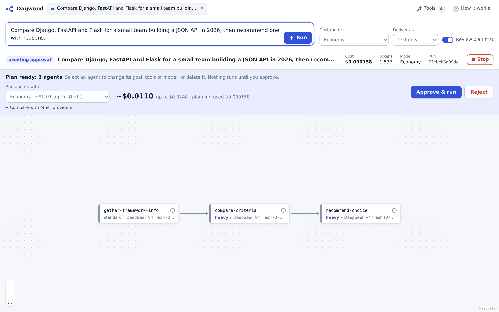
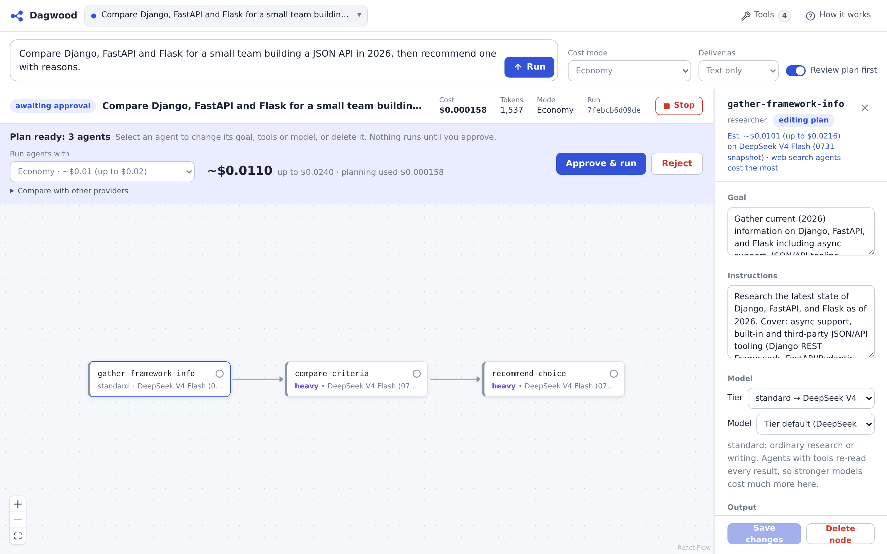
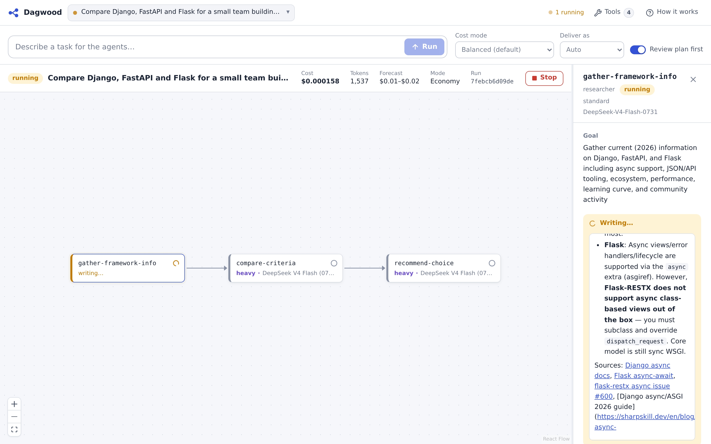
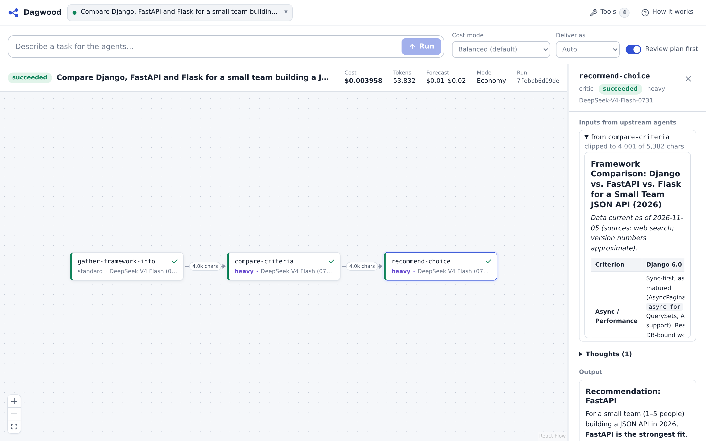

# Learn how agents work by watching them

*A visual, human-in-the-loop DAG of AI agents: what each agent sees, where you step in, and what
broke along the way.*

If you're learning how multi-agent systems work, most of the interesting parts are invisible. You
send a prompt, wait, and get an answer. Which agent did what? What did each one actually receive
from the others? Where could a human have stepped in? What did it cost, and why?

I built **Dagwood** to make those parts visible. You give it a task. A planner model breaks it into
a graph of worker agents. You review and edit that plan before anything runs. Then you watch the
agents work, live, and can click any of them to see exactly what it was given and what it produced.

It's small on purpose: about 9,000 lines of Python and TypeScript, with 148 tests that run without
API keys. A typical run costs well under a cent. The code is at
[github.com/zzorphcreator/dagwood](https://github.com/zzorphcreator/dagwood).

This article has two parts. The first is a guided tour of one real run, with a pointer to the code
behind each screen. The second is about what broke while I built it, because most of the
interesting design in an agent system exists because something failed first.

**One thing to be clear about up front.** Agents in Dagwood don't chat with each other. They
don't negotiate or hold a group conversation. Each agent receives the *outputs* of the agents it
depends on, and nothing else. If you came here to learn how agents talk to each other, that's the
answer I'd give you, and the tour shows why I think it's the right starting point.

A note on how it was built: I pair-programmed most of it with Claude Code. I made the design calls
and tested everything; the AI wrote a lot of the code. More on that at the end.

## The shape of the thing

```
task ──► planner ──► plan checks ──► human review ──► LangGraph executor ──► answer / PDF / slides
           ▲              │          (edit, re-route,     │   │   │
           └── retry ◄────┘           approve, reject)   agent agent agent  (each with tool + token caps)
```

- **Planner.** A [pydantic-ai](https://ai.pydantic.dev) agent whose output is a typed `DAGPlan`:
  a list of steps, each with a goal, tools, a difficulty tier and `depends_on`, the list of steps
  whose output it needs.
- **Plan checks.** A validator that rejects bad plans and sends the problems back to the planner.
- **Human review.** The plan appears as a graph. Nothing runs until you approve it.
- **Executor.** The plan becomes a [LangGraph](https://langchain-ai.github.io/langgraph/)
  `StateGraph`, which runs the agents in dependency order, in parallel where it can.
- **UI.** React + React Flow, with live updates over Server-Sent Events.

Models run on DeepInfra (one API key; DeepSeek V4 Flash by default). Web search and app tools
come from Composio, which is optional.

# Part 1: A guided tour of one run

Everything below is from a single real run in Economy mode. Total cost: **$0.0040**.

The task: *"Compare Django, FastAPI and Flask for a small team building a JSON API in 2026, then
recommend one with reasons."*

## 1. The planner draws a plan



The planner returned three agents in a chain: `gather-framework-info` (with web search), then
`compare-criteria`, then `recommend-choice`. Each arrow means "this step reads that step's output".
The planner also tagged each step with a tier. The research step is `standard`; the two reasoning
steps are `heavy`. The cost mode decides which model each tier runs on.

Planning cost $0.00016. The bar above the graph estimates the rest: about $0.011, up to $0.024.
That estimate comes from this server's own past runs, not from a formula.

**In the code:** the planner prompt and validator are in `orchestrator/factory.py`; the plan
schema is in `orchestrator/schema.py`.

## 2. You're in the loop



This is the human-in-the-loop part. While a plan is awaiting approval you can:

- open any step and change its goal, instructions, tools or model;
- switch the whole run to a different cost mode, and watch the estimate re-price;
- delete a step;
- reject the plan, or approve it and run it.

Once it's running there's one more control: **Stop**. Agents that already finished keep their
results, running ones are cancelled, and the rest are skipped.

In code, the gate is just a run status. If you ask for review, a finished plan goes to
`AWAITING_APPROVAL` instead of to the executor:

```python
def _after_planning(record: RunRecord, require_approval: bool) -> None:
    if require_approval:
        record.status = RunStatus.AWAITING_APPROVAL
        record.emit("awaiting_approval")
    else:
        record.status = RunStatus.PENDING
        _manager().submit(record, _launch)
```

Every editing endpoint (`PATCH /runs/{id}`, `PATCH` and `DELETE /runs/{id}/nodes/{node}`) starts
by checking that the run is still awaiting approval, and returns 409 otherwise, so a plan can't
change under a running executor. Approving re-validates the plan before scheduling it, because a
tool you enabled when the plan was made may have been disabled since.

Two details worth copying:

- **Deleting a step re-links the graph.** If you delete the middle step of A → B → C, then C now
  depends on A. Otherwise C would silently lose its input.
- **Approval records a forecast.** The estimate at approval time is saved with the run, so you can
  compare it to the real cost afterwards. That's how you find out the estimator is wrong.

What's *not* built: approving individual tool calls while an agent runs. For now, tools that
Composio marks as destructive are blocked outright. That's a good exercise (see the end).

## 3. Watch the agents work



After approval, the first agent starts. Its card shows what it's doing ("writing…"), and the panel
streams its output as the model generates it, with sources from its web searches. The other two
cards are waiting, because each depends on the step before it.

**In the code:** `orchestrator/live.py` turns pydantic-ai's stream events into a small in-memory
feed; `orchestrator/api.py` sends it to the browser over SSE.

## 4. See exactly what each agent received



This is the screen I'd point a learner to first. Clicking the final agent, `recommend-choice`,
shows **Inputs from upstream agents**: the output of `compare-criteria`, *clipped to 4,001 of
5,382 characters*. The labels on the arrows say the same thing: "4.0k chars".

That's the entire communication model. Here's the function that builds each worker's prompt:

```python
def render_prompt(task: str, node: DAGNode, deps: dict[str, str]) -> str:
    lines = [f"Task: {task}", f"Your goal for this step: {node.goal}"]
    if deps:
        lines.append("Inputs from previous steps:")
        for dep_id, output in deps.items():
            lines.append(f"- {dep_id}: {clip(output, dep_limit(node))}")
    lines.append("Produce your result.")
    return "\n".join(lines)
```

The task, its own goal, and its parents' outputs, each clipped to 4,000 characters (16,000 for a
final publishing step). No shared memory, no conversation history, no other agents.

That has a real cost, and you can see it in the screenshot: the recommender never saw the last
quarter of the comparison. But it makes the system easy to debug. When an answer is wrong, you
click the agent, read the exact prompt it got, and see whether the problem was upstream or in the
agent itself. With shared context or agent-to-agent chat, that question gets much harder to answer.

The run stats tell the other half of the story:

| Agent | Tools | Tokens in / out | Cost |
| --- | --- | --- | --- |
| `gather-framework-info` | web search | 44,138 / 3,112 | $0.0032 |
| `compare-criteria` | none | 1,364 / 1,443 | $0.0003 |
| `recommend-choice` | none | 1,269 / 969 | $0.0003 |

The one agent with a search tool cost 81% of the run. Both "heavy" reasoning steps together cost
less than a fifth of what it did. That pattern, where tool loops dominate cost rather than the number of
agents or the model tier, comes up again in Part 2.

# Part 2: What broke

## Failure 1: plans with no edges

Early on I submitted a task and got a graph with four boxes and no arrows: three research steps
and a "write the final report" step, all running at once. The report writer started with the
researchers, saw nothing, and wrote a confident report from its own general knowledge.

The planner had left every `depends_on` empty. It understood the report came *after* the research,
but nothing told it that edges were the only way information moved. After the tour above, you can
see why that matters: no edge, no input.

Two fixes, and you need both. First, the planner prompt states the consequence, not just the
format: *"Each step only sees the outputs of the steps listed in its depends_on, so any step that
analyses, combines, summarises or builds on earlier results must list those steps."* Second, the
validator checks for it:

```python
@agent.output_validator
def check_plan(ctx: RunContext[None], plan: DAGPlan) -> DAGPlan:
    problems = plan_problems(plan, catalog)   # cycles, unknown tools, unknown models, ...
    # A flat multi-step plan usually means a forgotten depends_on. Ask once;
    # a plan that really is all-parallel passes the second time.
    if not problems and len(plan.nodes) >= 3 and not plan.edges() and ctx.retry == 0:
        problems.append(
            "no step depends on another, so no step will see any other step's output. "
            "If a later step uses earlier results, add those ids to its depends_on. "
            "If every step is truly independent, return the same plan again"
        )
    if problems:
        raise ModelRetry("Fix these problems and return the plan again: " + "; ".join(problems))
    return plan
```

The `ctx.retry == 0` matters. Some tasks really are fully parallel, and a validator that rejected
them forever would just burn retries. So this check asks once instead of insisting. After the
change, 10 out of 10 live plans came back linked.

**When a model's output feeds code, the validator is where you write down what you meant.** Write
its errors as instructions the model can act on.

## Failure 2: fan-in that didn't wait

The obvious way to turn `depends_on` into LangGraph edges is one edge per parent:

```python
for dep in node.depends_on:
    graph.add_edge(dep, node.id)
```

That's wrong. LangGraph then schedules the node when *any* parent finishes, so a step with three
inputs can run after the first one. A single edge from the list of parents makes it wait for all:

```python
# List form makes LangGraph wait for ALL parents; one edge per parent would
# fire the node as soon as the first parent finishes.
graph.add_edge(list(dict.fromkeys(node.depends_on)), node.id)
```

Failures need the same care. If a parent failed or was skipped, a node marks itself `skipped`
instead of running on an error message. That check runs before any toolkit opens, so skipped
nodes cost nothing. Neither problem shows up in a happy-path demo.

## Failure 3: one agent, unbounded bill

The table in the tour shows the problem. A tool-using agent re-reads its whole conversation on
every step, including every earlier search result, so its input tokens grow much faster than its
number of tool calls. Some search agents needed 200k+ input tokens to finish.

So every agent runs under pydantic-ai `UsageLimits`: 8 tool calls for agents with external
toolkits, 40 for agents with only free built-in tools like `calc` (tiny results), and 300k input
tokens, or less if the model sets its own cap (the premium tier is capped at 100k). Hitting a
limit fails that one agent with a readable error, and its descendants are skipped. Tokens are
counted however an agent ends, including failures and stops, because the usage object is shared
with the agent rather than read off a result that a failed run never returns.

This also changed model routing. My instinct was "hard step, strong model". But search steps read
huge results, so a premium model there is the most expensive choice you can make. The planner
prompt now says search steps should be light or standard tier.

## Failure 4: charts with numbers nobody found

Dagwood can deliver a run as a PDF, slides or PPTX. The publishing agent returns a structured
`DocumentSpec`, and code renders it; the model never writes HTML, and the PDF renderer can't fetch
anything from the network.

Charts were the risk. A model asked for a chart will produce one whether or not the research found
any numbers. So every chart value has to appear in the text the publishing step was given
(allowing for thousands/millions/billions and 0.5% rounding), or the chart is dropped:

```python
def guard_charts(doc: DocumentSpec, source_text: str) -> tuple[DocumentSpec, list[str]]:
    """Drop charts with any value not found in the source text; returns the titles dropped."""
    numbers = numbers_in(source_text)
    dropped: list[str] = []
    sections = []
    for s in doc.sections:
        if s.chart and not all(_supported(v, numbers) for series in s.chart.series for v in series.values):
            dropped.append(s.chart.title)
            s = s.model_copy(update={"chart": None})
        sections.append(s)
    return doc.model_copy(update={"sections": sections}), dropped
```

It sometimes drops a chart that was fine. I'd rather lose a real chart than ship an invented one.

## Failure 5: the stream that hung the server

Not an LLM problem at all. The UI follows a run over SSE, and a run awaiting approval can wait
forever, so its stream stayed open forever. Then I edited a backend file. Uvicorn's `--reload`
waits for open responses before restarting, so the server just stopped answering, with nothing in
the logs.

The fix: every stream closes after 15 seconds (`STREAM_MAX_SECONDS`) and tells the browser to
reconnect a second later with `Last-Event-ID`. Run events are an append-only log, so resuming is
"send everything after this id". Live token output is deliberately different: it lives only in
memory, and a reconnect resends it from the start. What's saved to SQLite is each agent's finished
output, thoughts and tool calls.

## Failure 6: the graph that sometimes didn't fit

About one submit in four, the plan graph came up zoomed into a corner or with edges missing.
Reloading fixed it. The cause: every update rebuilt the React Flow nodes, and a node without a
`measured` size counts as not laid out yet, so `fitView` silently did nothing. The nodes are
fixed-size cards, so the fix was one line:

```ts
measured: { width: w, height: NODE_H },
```

The lesson was about verification. With a one-in-four bug, one good reload proves nothing. I only
trusted the fix after it held across dozens of real submits in a headless browser.

## Smaller things that mattered

The model client retries 429 overload errors up to 8 times with backoff, which rides out about 40
seconds of a busy provider. Each agent gets only the toolkits its step lists. Planner and workers
are told today's date, and anything "latest" must use search. And the cost estimator is honest
about its limits: it runs low for synthesis steps, which it prices at a flat ~4k input tokens,
and the README says so.

# Things to try

If you clone the repo, these are good ways to learn how the pieces fit:

1. **Run without the human.** Switch off "Review plan first" and submit the same task. The plan
   goes straight to the executor. Compare that with the `_after_planning` code above.
2. **Delete a middle step.** In a plan like the one in the tour, delete `compare-criteria` before
   approving. Watch `recommend-choice` get re-linked to the research step, then check its inputs
   after the run.
3. **Starve the agents.** Set `MAX_DEP_CHARS` in `orchestrator/executor.py` to 500 and run the
   same task. The edge labels and the inputs panel show how little the final agent now sees, and
   the answer gets worse.
4. **Make an agent fail.** Set `ORCHESTRATOR_MAX_TOOL_CALLS_PER_AGENT=1` and run a task that
   needs search. The search agent fails with "budget limit reached" as soon as it wants a second
   search, and every step downstream of it is skipped, with the reason in its log ("upstream …
   did not succeed"). On the task from the tour, that failed run cost $0.0008.
5. **Add a tool.** `orchestrator/custom_tools.py` has a placeholder tool, `team_handbook`, written
   as a plain function. Replace it with your own, and the planner can give it to steps that need
   it.
6. **Build the missing human-in-the-loop piece.** Add per-call approval: pause an agent when it
   wants to use a risky tool, ask the user, then continue or refuse. pydantic-ai's support for
   tools that require approval is a good place to start, and the approval-bar UI is a model for
   the prompt.

# What I'd tell someone building one of these

1. **Make data flow explicit.** If agents only see what their edges give them, every bad output
   traces back to a prompt you can read.
2. **Put the human gate in the state machine.** "Awaiting approval" as a real status, with every
   edit endpoint refusing to touch a running plan, is simpler and safer than a modal dialog.
3. **Validate model output like user input.** A planner is an untrusted client of your executor.
4. **Put a hard limit on every loop.** Tool loops, not agent count, decide the bill.
5. **Don't let the model make up evidence.** Check charts, numbers and citations against inputs.
6. **Test the plumbing.** Half of these failures were ordinary bugs in streams, schedulers and
   UI timing. pydantic-ai's test models let the whole suite run with no network and no cost.

On pair-programming with AI: it worked best because the system has hard edges. Plans are typed,
validators are plain functions, and the test suite runs in about a minute with no keys, so every
change had something to be checked against. Where it struggled was where that kind of check was
missing, like the one-in-four graph bug, which needed real repeated runs before I believed a fix.

Dagwood is a learning project: it runs locally, has no auth, and the README lists its known
limitations. If you want to watch a planner, a human gate and a DAG of agents work together, in
code you can read in an afternoon, it's at
[github.com/zzorphcreator/dagwood](https://github.com/zzorphcreator/dagwood).
